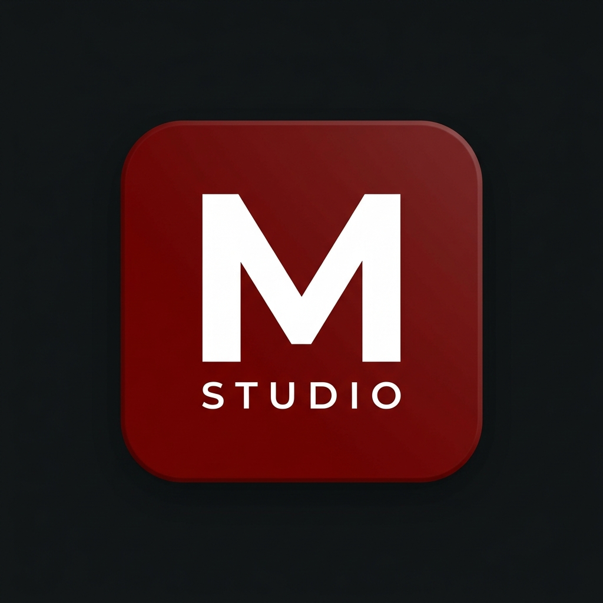

<div align="center" style="background: linear-gradient(135deg, #0A0A0A 0%, #1A050A 100%); padding: 40px; border-radius: 16px; border: 1px solid #262626; box-shadow: 0 10px 30px rgba(138, 21, 56, 0.1);">
  
  
  <h1 style="color: #F3F4F6; margin: 0; font-family: 'Inter', sans-serif; font-size: 3em; font-weight: 800;">
    MPEPE <span style="color: #8A1538;">Studio</span>
  </h1>
  <p style="color: #D4AF37; font-size: 1.2em; font-weight: 600; margin-top: 10px; letter-spacing: 2px; text-transform: uppercase;">
    The Ultimate Creator Ecosystem
  </p>

  <p style="color: #9CA3AF; font-size: 1.1em; max-width: 600px; margin: 20px auto; line-height: 1.6;">
    A unified creator platform designed to seamlessly manage YouTube channels, video/audio production workflows, and multiple social hubs all in one app.
  </p>

  <p align="center" style="margin-top: 30px;">
    
    
    
    
  </p>
</div>

<br>

## <span style="color: #8A1538;">✦</span> Overview
MPEPE Studio is a next-generation platform for content creators. Whether you are managing your personal vlog or a network of ten different channels, MPEPE Studio centralizes your workflow.

With built-in tools for **Video Production**, **Audio Production**, and direct **Social Integrations**, this app streamlines everything from shooting, editing, uploading, and analyzing content, straight from your device.

<br>

<div style="display: flex; flex-direction: row; gap: 20px;">

<div style="flex: 1; background-color: #141414; border: 1px solid #262626; border-left: 4px solid #8A1538; padding: 20px; border-radius: 8px;">
  <h3 style="margin-top: 0; color: #F3F4F6;">⚙️ Advanced Settings Hub</h3>
  <p style="color: #9CA3AF; margin-bottom: 0;">
    Fully configurable backend-driven settings using <b>Firebase Firestore</b>. Real-time updates for AI logic, App preferences, Push Notifications, and Privacy & Security configurations.
  </p>
</div>

<div style="flex: 1; background-color: #141414; border: 1px solid #262626; border-left: 4px solid #D4AF37; padding: 20px; border-radius: 8px;">
  <h3 style="margin-top: 0; color: #F3F4F6;">🤖 AI Automation</h3>
  <p style="color: #9CA3AF; margin-bottom: 0;">
    Configure AI models natively. Swap between Gemini and other cutting edge models to handle hook generation, b-roll injection, and automated social posting.
  </p>
</div>

</div>

<br>

## <span style="color: #8A1538;">✦</span> Project Architecture

This project follows a feature-first architecture using **Riverpod** for robust state management and **GoRouter** for seamless navigation.

| Directory | Description |
|-----------|-------------|
| <span style="color:#D4AF37;">🔒 `lib/auth/`</span> | Authentication logic (Firebase Auth) and beautiful login UI. |
| <span style="color:#D4AF37;">🎛️ `lib/settings/`</span> | **[NEW]** Comprehensive settings hub backed by `SettingsService` (Firestore). |
| <span style="color:#D4AF37;">📺 `lib/youtube_manager/`</span>| YouTube-specific features, including dashboards and AI video uploads. |
| <span style="color:#D4AF37;">🎬 `lib/video_production/`</span>| Video workflow management, tracking projects, crew, and equipment. |
| <span style="color:#D4AF37;">🎵 `lib/audio_production/`</span>| Audio workflow, music library, and artist management. |
| <span style="color:#D4AF37;">💬 `lib/social_hub/`</span> | Social interactions, TikTok automation, and unified inbox. |

<br>

## <span style="color: #8A1538;">✦</span> Desktop Connectivity Plugins

We have built a groundbreaking, multi-layered native plugin architecture that connects your mobile device directly to industry-standard production software via Firebase and AI.

- **Adobe Premiere Pro (Phase 1)**: Native Adobe CEP plugin (`/plugins/mpepe_premiere_connect`). Runs a Node.js instance listening to your phone's AI commands and executing ExtendScript (`.jsx`).
- **DaVinci Resolve (Phase 2)**: Integrated advanced multi-agent color grading into a native Python Bridge (`/plugins/mpepe_davinci_connect`). Hooks into DaVinci's internal API.
- **Native Audio DAWs (Phase 3)**: Foundational C++ VST3/AudioUnit plugin using the **JUCE Framework** (`/plugins/mpepe_audio_connect`). Interfaces with Logic Pro, FL Studio, and Cubase.

<br>

## <span style="color: #8A1538;">✦</span> Setup Instructions

### 1. Install Dependencies
```bash
flutter pub get
```

### 2. Configure Firebase
- Ensure Firebase is configured for your target platforms (Windows, iOS, Android, macOS).
- Place `firebase_options.dart` in the `lib/` directory.

### 3. Run the App
Launch the studio on your preferred device:
```bash
flutter run
```

<br>

<div align="center" style="margin-top: 40px; padding: 20px; border-top: 1px solid #262626;">
  <p style="color: #9CA3AF;">Built with passion by <strong style="color: #8A1538;">MPEPE</strong> to empower creators.</p>
</div>
