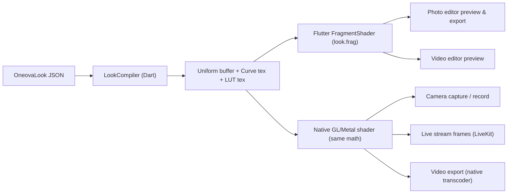
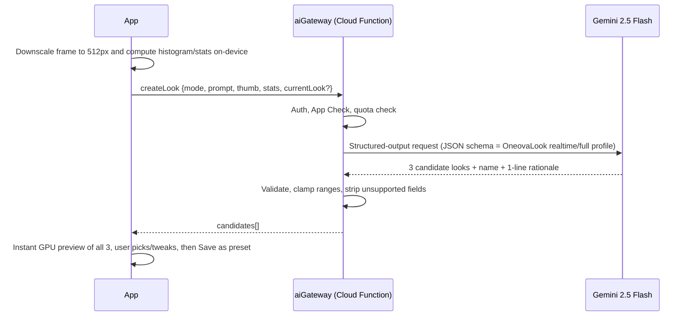

# Oneova Filter System — Plan (for your review, nothing built yet)

**Goal:** one filter system that works the same way in **Live**, **Camera capture** (Reels/Stories), the **Photo Editor** and the **Video Editor**. Users can pick a filter, fine-tune it, **have AI make one for them**, save it as a preset, and share or reuse it anywhere.

---

## 1. What the codebase has today (audit)

There are **7 separate color/preset models**, and none of them can talk to each other:

| Model | File | Used by | State |
|---|---|---|---|
| `CinemaPreset` | [cinema_preset.dart](file:///Users/imac/Music/MPEPE%20STUDIO/lib/create/models/cinema_preset.dart) | Create / Pro editor | Has fields + `aiPrompt`, but rendering isn't hooked up |
| `StudioPreset` / `PresetEngine` | [preset_manager.dart](file:///Users/imac/Music/MPEPE%20STUDIO/lib/backend/photo_studio/preset_manager.dart) | Photo Studio | Semantic mask layers (face/skin/bg). Good idea, only partly built |
| `PhotoPreset` | `backend/photo_studio/photo_studio_models.dart` | Photo Studio | Duplicates the one above |
| `ColorPreset` / `ColorState` / `LutStage` | `backend/projects/models/pro_project_models.dart` | Video projects | Static map of 3 presets |
| `OneovaColorGrade` | `backend/projects/models/oneova_draft_model.dart` | Drafts | Separate again |
| `ColorGradingPayload` | [universal_mask_models.dart](file:///Users/imac/Music/MPEPE%20STUDIO/lib/backend/mask_engine/universal_mask_models.dart#L329-L368) | Masks | Only 7 params |
| `LiveBeautyConfig` | [live_models.dart](file:///Users/imac/Music/MPEPE%20STUDIO/lib/backend/live/models/live_models.dart#L111-L155) | Live | 4 params; **saved but never actually applied to the stream** |

**Rendering is mostly placeholder code:**
- [PhotoColorEngine.compileRealtimePreviewShader](file:///Users/imac/Music/MPEPE%20STUDIO/lib/backend/photo_studio/photo_color_engine.dart#L17-L42) returns `null`. The eyedropper returns hard-coded values.
- [LutNode.execute](file:///Users/imac/Music/MPEPE%20STUDIO/lib/backend/rendering/graph/nodes/lut_node.dart#L19-L40) passes the frame through unchanged.
- `LutLibrary` points to `luts/*.cube`, but **those files don't exist**. The only shader in `shaders/` is `fluid_trackpad.frag`.
- In `camera_screen.dart`, "Beauty" is just a white overlay at reduced opacity, not real skin smoothing.
- Live publishes through `livekit_client` / `flutter_webrtc`. Nothing currently processes frames before they're sent.
- Video export uses only `video_compress`, which can't apply filters when exporting.
- AI: `functions/src/aiGateway.ts` (Gemini 2.5 Flash) already exists and can be reused.

> [!IMPORTANT]
> The biggest job isn't the UI. It's **one shared look format + one rendering engine** that every surface uses, so a filter looks exactly the same in Live, in the photo editor and in the exported video.

---

## 2. Core concept: the "Oneova Look"

One versioned JSON document (`OneovaLook`) describes any filter. A filter, a preset, an AI-made look and a shared look are all the same object.

```
OneovaLook (schemaVersion: 1)
├─ meta: id, name, ownerUid, category, tags, thumbnailUrl, source(builtin|user|ai|remix), parentLookId
├─ intensity: 0–1                  ← master slider (blends original → full look)
├─ light:   exposure, contrast, highlights, shadows, whites, blacks, brightness
├─ color:   temperature, tint, vibrance, saturation
├─ curves:  master/R/G/B control points (baked to 256×1 texture)
├─ hsl:     8 bands × (hue, sat, lum)
├─ grading: shadows/midtones/highlights wheels + balance (split-tone)
├─ lut:     { url | builtinId, size 17/33, intensity }      ← optional 3D LUT
├─ effects: grain, vignette, sharpen, clarity, dehaze, glow/bloom, fade,
│           chromatic aberration, light-leak overlay, blur
├─ beauty:  smooth, even tone, brighten eyes, whiten teeth, slim (Phase 3+)
├─ background: none | blur(level) | replace(imageUrl) | color   (needs segmentation)
└─ selective[]: semantic targets (skin/sky/hair/bg/face) → sub-adjustments
               (reuses the StudioPreset/PresetInstruction idea)
```

**Rules**
- Every parameter has a defined range and a default of 0 (no effect). The server rejects or clamps anything out of range, which also covers AI output.
- **Live and camera support a subset** (the "realtime profile": light, color, curves, LUT, grain, vignette, beauty, background). Photo and video support everything. The UI shows a "Some effects are editor-only" badge when a look uses unsupported parts.
- **Migration:** add one-way adapters (`CinemaPreset → OneovaLook`, `ColorState → OneovaLook`, `LiveBeautyConfig → OneovaLook.beauty`, and so on). Old models stay in place and get deprecated gradually. This is forward-only editing: nothing is deleted or reverted.

---

## 3. Rendering engine: one pipeline, four surfaces



| Surface | How frames get filtered | Notes |
|---|---|---|
| **Photo editor** | `ui.FragmentProgram` with `shaders/look.frag` in Dart. Export by rendering to an image at full resolution | Pure Flutter, works on every platform |
| **Video editor preview** | Video texture → `ImageFiltered`/shader layer per clip | Preview is GPU-only, so scrubbing stays real-time |
| **Video export** | Native: **Android Media3 Transformer + GL effect**, **iOS AVVideoComposition + CIFilter/Metal** | Alternative: an FFmpeg fork (decision Q2) |
| **Camera capture** | Native camera texture → GL/Metal → preview + recorder | The `camera` package can't process frames on the GPU, so this needs a small native plugin |
| **Live** | Hook into the WebRTC capture pipeline (Android `VideoProcessor`, iOS capturer delegate) before encoding, so **viewers see the filter**, not just the host | Needs a technical spike first. This is the riskiest item |

**Keeping it consistent:** one GLSL source of truth. The Dart shader and native shaders are built from the same `.frag`, and Metal gets it via SPIR-V cross-compiling. Golden-image tests render 20 reference looks on all paths and require less than 1% ΔE difference.

**Performance targets**
- Live/camera: **720p at 30fps, filter pass under 6ms** on a mid-range Android device (e.g. Galaxy A54).
- Automatic device tiers: low-end phones turn off beauty and background effects and use a 17³ LUT instead of 33³.
- Thermal watchdog: when the phone gets hot during a live, quality drops in steps (background → beauty → grain) instead of dropping frames.

**Segmentation and face detection** (for background, beauty and selective edits): on-device ML Kit Selfie Segmentation and Face Mesh, or MediaPipe (decision Q3). It runs at half resolution and the mask is upscaled.

---

## 4. Filter catalog per surface

### 4.1 Built-in library (Oneova-branded, ~40 looks at launch)
| Category | Examples |
|---|---|
| **Natural** | Clean, True Tone, Soft Daylight, Studio Neutral |
| **Portrait** | Glow Skin, Warm Portrait, Matte Beauty, Golden Hour |
| **Cinematic** | Oneova Cine, Teal & Amber, Night City, Obsidian Prime (reuses `ColorScienceStandard` names) |
| **Film** | Classic 200, Faded 90s, Mono Silver, Instant |
| **Vibe** | Neon Pink (brand accent), Cool Blue, Dreamy, Moody |
| **B&W** | Pure Mono, High-Key, Noir |
| **Food / Travel / Product** | Fresh, Vivid Travel, Product White |
| **Live-optimized** | Ring Light, Stream Clean, Low-Light Boost |

Built-ins live in `assets/looks/*.json` plus `assets/luts/*.png` (LUTs stored as 512×512 PNG atlases, which are smaller and faster than `.cube`). Remote Config can add new seasonal packs without an app update. This is real catalog content, not fake data.

### 4.2 Per-surface features
| Feature | Live | Camera | Photo | Video |
|---|:-:|:-:|:-:|:-:|
| Swipe-to-change filter carousel | ✅ | ✅ | ✅ | ✅ |
| Intensity slider (long-press on a filter) | ✅ | ✅ | ✅ | ✅ |
| Hold-to-compare (before/after) | host only | ✅ | ✅ | ✅ |
| Beauty (smooth, tone, eyes) | ✅ | ✅ | ✅ | ✅ (per clip) |
| Background blur / replace | ✅ | ✅ | ✅ | ✅ |
| Full Adjust panel (light/color/curves/HSL/wheels) | Quick sliders only | Quick sliders only | ✅ | ✅ |
| Selective / masked adjustments | — | — | ✅ (existing mask engine) | ✅ (tracked masks, later) |
| Per-clip vs global (adjustment layer) | — | — | — | ✅ |
| Keyframed intensity / filter transitions | — | — | — | ✅ |
| Scheduled filter "scenes" (hotkeys) | ✅ | — | — | — |
| Copy / paste look between items | — | — | ✅ batch | ✅ across clips |
| AI create / refine | ✅ (pre-live + tray) | ✅ | ✅ | ✅ |

### 4.3 Live specifics
- **Pre-live (Go Live wizard step 3):** choose look, beauty, background; preview at real stream quality. This replaces the current toggle that doesn't apply anything.
- **During live:** a compact filter tray (bottom sheet about 180px tall). Switching looks **cross-fades over 300ms with no stream reconnect**.
- **Scenes:** the host saves up to 4 "scenes" (look + background) and switches with one tap.
- **Viewer side:** nothing to process. The filter is already part of the encoded video.
- Multi-guest Live Studio: each participant applies their own look locally.

---

## 5. AI Filter Creator

### 5.1 Modes
1. **Describe it:** e.g. "warm 90s film with pink highlights" → 3 look variants.
2. **Match a photo:** upload any reference image → AI recreates its look. This reuses the idea in the existing `PresetExtractionEngine`, with histogram and color-statistics matching done on-device first and AI refining it.
3. **Auto-Enhance:** one tap; AI analyzes *your* frame (exposure, white balance, skin) and builds a corrective look.
4. **Refine by chat:** "a bit warmer", "less contrast", "make skin softer". This changes the current look step by step instead of starting over.
5. **Fix for live:** analyzes the camera frame before going live (lighting, white balance, noise) → suggests the "Live-optimized" look.

### 5.2 Pipeline

- **The AI outputs parameters, not pixels.** That makes it instant, cheap, editable afterwards, and reproducible. A generated LUT is optional later: the AI picks a palette and the client builds a 33³ LUT from it.
- New callable function: `createLook` (or a new `task: 'look'` mode on the existing `aiGateway`).
- Logged to `aiLookJobs/{id}` (prompt, result, chosen variant) so the prompt can be improved over time.
- **Limits:** free tier N generations/day, Pro unlimited (decision Q5). Refining an existing look counts as half a generation.
- Safety: images are only used for analysis and never stored, unless the user saves a "match photo" reference.

---

## 6. Presets: save, organize, share, remix

**Save flow:** any time a look is modified → "Save Look" → name (AI suggests one), category, auto-generated thumbnail rendered from the current frame, and a choice of private, followers or public.

**My Looks library** (Me → Creator tools → My Looks, and also inside every filter tray):
- Favorites row (always first in every carousel), folders/collections, recently used
- Edit, duplicate, rename, delete (**delete asks for confirmation**)
- Sync across devices via Firestore real-time stream

**Sharing and social (growth loop):**
- Posts and Reels record the look used → a "Filter: *Golden Hour* by @user" pill on the post → tap → **Try this look** opens the camera with it applied.
- Remix: save someone's public look as your own copy (tracked with `parentLookId` for attribution).
- Look page: preview, use count, creator, "Use in Live / Camera / Editor".
- Import/export: `.oneovalook` file or link/QR. Importing `.cube` LUTs is a Pro feature. Lightroom `.xmp` import is a later option.
- Optional later: a Looks marketplace (paid packs with creator revenue share).

---

## 7. Data model (Firestore + Storage)

```
users/{uid}/looks/{lookId}          OneovaLook + {createdAt, updatedAt, favorite, folderId, visibility}
users/{uid}/lookFolders/{folderId}
publicLooks/{lookId}                denormalized public copy + {useCount, saveCount, creator{uid,name,avatar}}
publicLooks/{lookId}/uses/{uid}     one-per-user use/save record (enforces uniqueness)
posts/{postId}.lookRef              {lookId, name, creatorUid}
aiLookJobs/{jobId}                  server-written only
Storage: looks/{uid}/{lookId}/thumb.jpg, lut.png
```
- Rules: owner-only write on `users/{uid}/looks`; `publicLooks` writable only through a Cloud Function (`publishLook`) that validates the schema; counters are updated by functions. Rules authoring would go through the firestore-rules subagent.
- Indexes: `publicLooks` by `category + useCount`, by `createdAt`.

---

## 8. UX spec (follows Oneova UI rules)

- **Filter carousel:** 56×56 rounded thumbnails (`AppRadius.md`), the active one gets a 1px `brandBlue` ring, 10.5px labels, "AI ✦" chip first and **brandPink** "New" badges. Previews render live on the actual frame.
- **Intensity:** long-press a thumbnail → slim horizontal slider with a percentage label, haptic tick at 0/50/100.
- **Adjust panel:** tabs Filters · Adjust · Curves · HSL · Grade · Effects · Beauty · Background · AI. Uses `TabBar` + dense sliders, works in light and dark mode.
- **AI sheet:** prompt field (dense), suggestion chips ("Golden hour", "Clean studio", "Moody night"), Match-photo button, 3 result cards → "Use" / "Refine" / "Save".
- Every screen has a back path (`context.push`), and confirmations appear before delete or discarding unsaved edits.

---

## 9. Phased roadmap

| Phase | Scope | Main deliverables | Est. |
|---|---|---|---|
| **0. Spikes** | De-risk | (a) Native frame hook into LiveKit/WebRTC on Android + iOS, (b) Media3/AVFoundation export with shader, (c) ML Kit segmentation fps on a mid-range device | 1 wk |
| **1. Foundation** | Look format + engine | `OneovaLook` model + JSON schema, `LookCompiler`, `look.frag`, LUT atlas loader, golden tests, adapters from the 7 legacy models | 2 wks |
| **2. Photo editor** | First surface (pure Flutter) | Filters carousel, full Adjust panel, real `PhotoColorEngine` (replaces the null stub), real eyedropper, export | 1.5 wks |
| **3. Presets + library** | Save/sync | My Looks, folders, favorites, thumbnails, Firestore + rules, built-in pack of 40 | 1 wk |
| **4. AI Creator** | AI | `createLook` function, Describe / Match / Auto-Enhance / Refine, quotas | 1.5 wks |
| **5. Video editor** | Timeline | Per-clip + adjustment layer, keyframed intensity, native export with filters | 2 wks |
| **6. Camera capture** | Reels/Stories | Native GPU camera plugin, swipe filters, beauty and background, record with look baked in | 2 wks |
| **7. Live** | Streaming | Filters in the WebRTC pipeline, pre-live step, in-live tray, scenes, thermal fallback | 2 wks |
| **8. Social** | Growth | Look attribution on posts, Try this look, public looks, remix, import/export | 1 wk |

Phases 2→4 deliver user value quickly with low risk. Live goes last because it depends on the spike.

---

## 10. Risks

| Risk | Mitigation |
|---|---|
| WebRTC frame processing on iOS is complex | Spike first. Fallback: a custom capturer that feeds processed frames into LiveKit as a custom video source |
| Looks differ between Dart and native shaders | Single GLSL source + golden ΔE tests in CI |
| Low-end devices drop frames | Device tiers + thermal watchdog |
| AI returns bad or extreme values | JSON schema + server clamping + show 3 variants |
| FFmpeg licensing / the original `ffmpeg_kit` is retired | Prefer native Media3/AVFoundation |

---

## 11. Decisions I need from you

1. **Order of rollout:** is Photo → Presets → AI → Video → Camera → Live OK, or is Live the top priority?
2. **Video export engine:** native (Media3 + AVFoundation; best quality, more code) or an FFmpeg fork (one codebase, bigger app, licensing to check)?
3. **Segmentation/face:** Google ML Kit (simpler) or MediaPipe (better quality, face mesh on iOS too)?
4. **AR face effects** (masks, stickers, makeup): include in this plan or treat as a separate future project?
5. **Monetization:** AI generation limits per tier? Paid look packs / creator marketplace?
6. **Platforms:** Android + iOS only for camera/live filters, with desktop/web limited to the photo/video editors?

Once you approve or adjust these, I'll turn the chosen phases into a task-by-task implementation plan.
